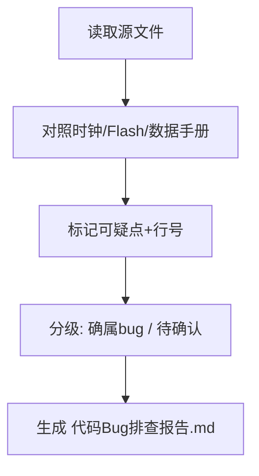

## 用户需求

检查工程内的项目代码，列出可能的 bug 位置（仅做排查与定位，不修改代码）。

## 产品概述

本工程为 STM32F407 + DP83848 PHY + LwIP(no RTOS) + ADS8354 三路 SPI ADC + 三段式 IAP Bootloader 的嵌入式固件。需要系统性静态排查，输出可疑 bug 的位置清单（文件+行号+根因+风险等级），作为后续修复依据。

## 核心排查范围

- LwIP 网络初始化与 IP/配置窗口逻辑
- TCP echo server 协议命令解析与 pbuf 处理
- net_config Flash 持久化与越界保护
- TIM7 采样定时器周期与 SysTick 调用冲突
- USART 环形缓冲组装与发送重入
- ADS8354 SPI 三路 CS/外设映射与 SDO 模式
- main.c / stm32f4xx_it.c 中断上下文安全
- CMake 源文件编入与链接完整性

## 技术栈

- MCU: STM32F407VG (Cortex-M4, 168MHz, no RTOS)
- 网络: LwIP 2.x (RAW API, NO_SYS=1)
- 外设: SPI1/2/3 (ADS8354 ADC), USART1/2/3, TIM7 (采样定时), ETH + DP83848
- 存储: 内部 Flash Sector 11 (0x080E0000) 存 IP 表
- 构建: CMake + arm-none-eabi-gcc

## 实现方案

本任务为"代码审查 / Bug 排查"，不写新功能，而是对现有代码做逐项静态走查，并对照数据手册、CubeMX .ioc、链接脚本、Flash 布局验证，最终产出结构化 bug 清单。

### 关键技术决策

1. **按模块分级排查**：将工程拆分为 8 个风险域（见目录结构），逐项核对。优先排查中断安全、数组越界、缓冲区溢出、状态机并发这四类最易引发硬故障的问题。
2. **对照权威来源验证**：定时器周期需对照 `SystemClock_Config` (HSE 25M→PLL 336/2=168MHz) 计算；Flash 布局需对照 `STM32F407XX_APP.ld` 与 Bootloader 的 `boot_valid` 地址 0x0800FFFC；SPI 模式需对照 ADS8354 数据手册 CFR 寄存器位定义。
3. **复用现有代码模式**：不引入新工具；排查结果以"文件:行号 + 现象 + 根因 + 建议"表格形式落到技术文档，与现有 `技术文档.md` / `USART_CHANGES_SUMMARY.md` 风格一致。

### 性能与可靠性考量

- 排查本身零运行时开销，但产出清单应标注"高/中/低"风险，便于用户优先修复会直接导致 HardFault 或网络死锁的项（如 pbuf 链未处理、uint32 回绕、Flash 越界）。
- 区分"确属 bug"与"需需求确认"（如网关 0.0.0.0、100us vs 200us、配置窗口未切换），后者在清单中单列"待确认项"。

## 实现说明（执行要点）

- 不修改任何源文件，仅读取与交叉验证。
- 对 `tcp_echoserver.c` 的 pbuf 分片、net_config 的 active_idx 越界、usart.c 的环形缓冲回绕、ads8354.c 的 CS/外设错配做重点走查。
- 最终输出写入新文档 `代码Bug排查报告.md`，并引用精确行号。

## 架构设计

本任务为审查型，无架构改动。数据流仅涉及"读代码 → 对照参考 → 记录结论"。



## 目录结构

```
c:/ST_project/DP83848/
├── 代码Bug排查报告.md        # [NEW] 排查结论清单。按 8 个风险域组织，每条含 文件:行号、现象、根因、风险等级、修复建议；末尾单列"待用户确认项"。
├── Core/Src/tcp_echoserver.c # [READ] 重点核对 NetConfigHandleReq 长度宏溢出、pbuf 链分片未处理、recv 回调内 UART_Send / Flash 擦写阻塞。
├── Core/Src/net_config.c     # [READ] 核对 save/load 逻辑矛盾、active_idx 越界、sscanf 未校验 255、Sector/VOLTAGE 参数。
├── Core/Src/usart.c          # [READ] 核对 UART_RxFlat uint32 回绕、UART_RingPush 满覆盖、UART_Send 重入。
├── Core/Src/tim.c            # [READ] 核对 MX_TIM7_Init Prescaler/Period 实际周期(100us vs 200us)。
├── Core/Src/main.c           # [READ] 核对 SysTick_Handler 调用 tcp_echoserver_tim7_isr 的上下文安全。
├── Core/Src/stm32f4xx_it.c   # [READ] 核对 TIM7/SysTick 双调用路径。
├── LWIP/App/lwip.c           # [READ] 核对 GATEWAY 0.0.0.0、配置窗口切换缺失。
├── ADS8354/ads8354.c         # [READ] 核对三路 CS 与 hspi 句柄错配、SDO 模式字节数、CS 未释放。
└── CMakeLists.txt            # [READ] 核对 lwip.c / tcp_echoserver.c / net_config.c 是否已编入源列表。
```