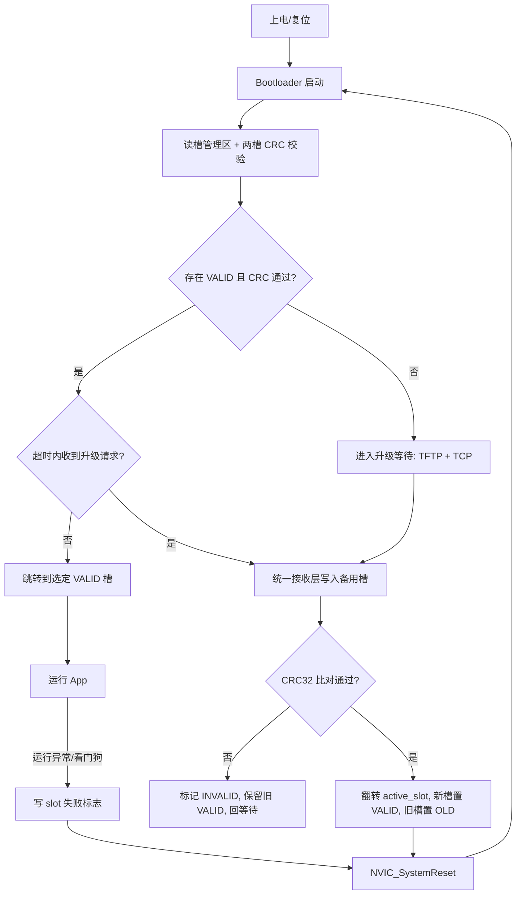
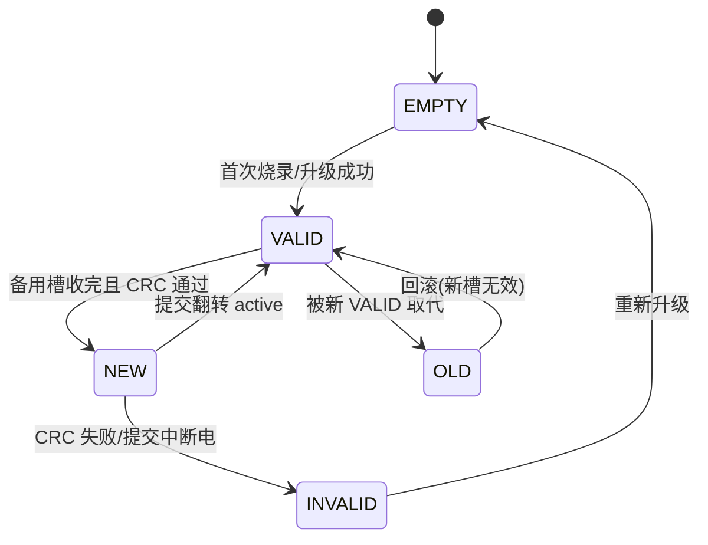

## 用户需求

用户当前工程的 IAP 由 AI 生成，升级过程不顺利且不会调试，希望**重写 IAP**。已确认的关键选型：

- 升级通道：同时支持 **PC 直连以太网 TFTP**、**上位机软件（TCP/私有协议）**、**浏览器 HTTP 上传** 三条。
- 镜像结构：采用 **双 Bank(A/B) 备份**，要求升级失败能自动回滚。
- 调试痛点：不会用调试器、TFTP 交互不透明、Flash 布局混乱，规划须配套可视化日志/进度与清晰分区图。

## 产品概述

在 STM32F407VG（单 bank 1MB Flash，无硬件双 bank）上重写 IAP：保留独立 Bootloader，将 App 区软件模拟为 A/B 两个镜像槽，用状态标志 + CRC32 + 版本号头部实现"升级失败自动回滚"；Bootloader 同时支持 TFTP、上位机 TCP 私有协议、浏览器 HTTP 上传三条升级通道，抽象统一的"固件接收层"；并针对调试痛点提供黑盒日志、LED 状态编码、清晰 Flash 分区图与升级状态机图。

## 核心功能

- IAP 整体实现流程（上电→Bootloader 决策→A/B 选择→接收→校验→切换→回滚）。
- 升级方法对比与统一接收层抽象（TFTP / 自定义 TCP / HTTP / Ymodem / DFU）。
- 软件 A/B 双备份：Flash 分区、槽状态机、防断电撕裂的双阶段提交标志。
- Bootloader 重写：健壮启动决策、双通道接收、看门狗/超时、进度上报。
- 调试可观测性：UDP/TCP 状态广播 + LED 编码 + 可选 USART 日志 + 分区图文档。

## 技术栈选择

- MCU：STM32F407VG，Cortex-M4，168MHz，无 RTOS，CubeMX + CMake + arm-none-eabi-gcc。
- 网络：LwIP 2.1.2 RAW API（NO_SYS=1），复用现有 `lwip_boot.c` 与 `ethernetif.c`。
- 存储：内部 Flash（Bootloader sector0-3；App 区 sector4-10 软件劈成 A/B 槽；net_config 固定在 sector11 禁止擦除）。
- 校验：CRC32（以太网多项式 0xEDB88320），与现有 `tftp_server.c` / `net_config.c` 实现保持一致。

## 实现方案

### 整体流程（关键决策）

1. **上电**：Bootloader 启动，读"槽管理区"头部（magic/state/crc/version）。
2. **决策**：选 state==VALID 且 CRC 通过的槽作为运行槽；若无有效槽则进入升级等待。
3. **正常启动**：超时（如 3s）无升级请求则跳转到选定槽（设 VTOR + MSP + PC，走 `NVIC_SystemReset()` 后的干净跳转）。
4. **升级接收**：收到 TFTP、TCP 私有协议 或 HTTP POST 固件流 → 写入"备用槽"（非当前运行槽）。
5. **校验与提交**：收完算 CRC32 比对，通过则把备用槽 state 置为 VALID、当前槽置为 BACKUP/OLD，最后复位。
6. **回滚**：下次启动若新槽 CRC 失败或 App 自检出错（看门狗/标志），自动回退到旧 VALID 槽。

### 软件双 bank（核心约束）

- F407VG 单 bank，不支持 BFB2，因此"双 bank"是**软件模拟**：App 区 0x08010000–0x080E0000（832KB）对半切，A 槽 0x08010000、B 槽 0x08070000（每槽 384KB，留余量）。需在实现前确认 App 实际体积 ≤ 384KB（待确认 Q1）。
- 槽管理区：在 Bootloader 末尾（sector3 末，或独立小扇区）存 `boot_slot_t`：active_slot、slot[2].state、slot[2].crc32、version。state 枚举：EMPTY/VALID/NEW/INVALID/OLD。
- **防断电撕裂**：采用两阶段提交的"双标志"——先写 `erasing_new`（擦备用槽中）→ 收完校验通过写 `commit_pending` → 最后原子翻转 `active_slot` 并置 NEW 槽 VALID。任意阶段断电，重启后都能根据标志恢复到确定状态，不会既丢新固件又毁旧固件。

### 双通道统一接收层（关键决策）

- 抽象 `iap_rx_if`：提供 `rx_begin(slot_addr,total_len)` / `rx_write(offset,buf,len)` / `rx_end()` / `rx_abort()`。
- TFTP server 与 TCP 私有协议都只实现该接口，底层写入逻辑（缓冲→Flash 懒擦除→CRC 累加）完全共用，消除现有 tftp_server.c 与 tcp 路径重复且不一致的问题。
- TFTP 维持 WRQ 流程，但修复现有 bug：分片包用 `pbuf_copy_partial` 拼合、严格块号窗口、末包判据仅在"期望块且长度不足"成立。
- HTTP 通道：Bootloader 内嵌极简 HTML 页面，浏览器访问设备 IP → 拖拽/选择 .bin 文件 → HTTP POST multipart/form-data → 逐块接收写入 `iap_rx`。协议标准、无需客户端软件，天然支持远程网页升级。

### 调试可观测性（针对用户痛点）

- **不用调试器也能看状态**：Bootloader 阶段用 UDP 广播当前阶段/进度（如 "IAP:BOOT slotA valid" / "RECV 45%"）；LED 用不同闪烁频率编码状态（等待/接收中/校验/失败）。
- **TFTP 透明化**：每块回 ACK 且累计计数；收完把 CRC 结果通过协议返回上位机（TFTP 可用 OACK 或 ERROR 携带），上位机界面直接显示到第几块、CRC 是否通过。
- **Flash 布局文档化**：实现时生成 `IAP_Flash_Layout.md` 分区图 + 状态机图，解决"布局混乱"。
- 保留一段 USART 日志（即使串口是测试项，Bootloader 自举期仍可用作黑盒日志，便于无网络时排错）。

### 链接脚本修正（必做）

- `STM32F407XX_APP.ld` 当前 FLASH ORIGIN=0x08000000 与 Bootloader 重叠（已确认 bug）。重写时改为 A 槽 `0x08010000` 或 B 槽 `0x08070000`，并配套在构建里通过宏切换当前编译目标槽；Bootloader 链接脚本保持 64KB 不变。

## 实现说明（执行要点）

- 不修改 net_config（sector11）相关逻辑，升级过程禁止触碰 sector11。
- 复用 `flash_if.c` 的 `FLASH_Get_Sector/FLASH_If_Erase_Sector/FLASH_If_Write`，扩展为按槽地址擦写。
- CRC32 算法与现有代码保持一致，避免不一致。
- Bootloader 跳转 App 统一走 `NVIC_SystemReset()` + `jump_to_app()`，不再裸函数指针跳。
- 升级接收全程开独立 IWDG，防止网络卡死变砖。

## 架构设计



软件双 bank 槽状态机：



## 目录结构

```
c:/ST_project/DP83848/
├── IAP_Flash_Layout.md          # [NEW] Flash 分区图 + 槽状态机图 + 升级流程说明（解决布局混乱）
├── Bootloader/
│   ├── bootloader_main.c        # [MODIFY] 重写启动决策：读槽管理区、A/B 选择、超时跳 App、双通道入口
│   ├── iap_slot.h               # [NEW] 槽管理结构体、state 枚举、A/B 槽地址宏、双阶段提交标志
│   ├── iap_slot.c               # [NEW] 槽选择/校验/提交/回滚逻辑（CRC32 复用）
│   ├── flash_if.c/.h            # [MODIFY] 扩展支持 A/B 两槽地址擦写，保持 sector11 保护
│   ├── iap_rx.c/.h              # [NEW] 统一固件接收层接口（rx_begin/write/end/abort）
│   ├── tftp_server.c/.h         # [MODIFY] 重写为实现 iap_rx 接口，修复分片/块号/末包 bug
│   ├── http_server.c/.h         # [NEW] 极简 HTTP 服务器（HTML 上传页面 + POST 固件流 → iap_rx）
│   ├── tcp_upgrade.c/.h         # [NEW] 上位机 TCP 私有协议升级，复用 iap_rx 接口
│   ├── lwip_boot.c              # [REUSE] 复用/精简 Bootloader LwIP 初始化
│   ├── iap_log.c/.h             # [NEW] 黑盒日志：UDP 广播 + LED 编码 + 可选 USART
│   └── STM32F407XX_BOOT.ld      # [KEEP] 保持 64KB 不变
├── Core/Src/
│   ├── tcp_echoserver.c        # [MODIFY] 改造/新增 App 侧 TCP 升级接收与 CMD_ENTER_BOOTLOADER（写回 Bootloader）
│   └── net_config.c            # [KEEP] 不变，sector11 受保护
└── STM32F407XX_APP.ld          # [MODIFY] FLASH ORIGIN 改为 A 槽 0x08010000（修正重叠 bug），支持按槽切换
```

## Agent Extensions

### SubAgent

- **code-explorer**
- Purpose: 在实现前深入核对 App 实际 Flash 体积、net_config 区边界、现有 tftp_server 与 tcp_echoserver 的接收路径细节，确保重写方案与现有代码精确对接。
- Expected outcome: 产出精确的 App 体积评估、A/B 槽地址可行性确认、以及现有接收逻辑的可复用点清单，作为实现阶段的准确输入。