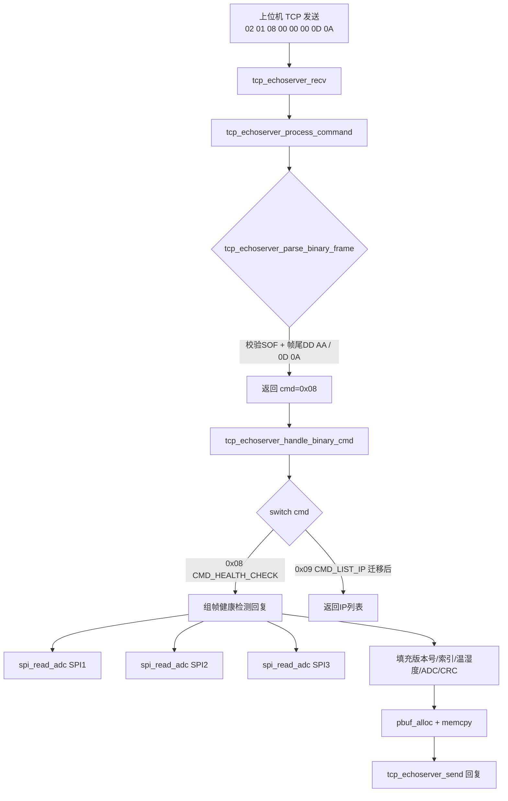

## 用户需求

单板需要实现健康检测功能：下位机接收上位机下发的8字节十六进制命令帧 `02 01 08 00 00 00 0D 0A`，收到后回复26字节的健康检测数据帧。

## 产品概述

在现有 STM32F407 + DP83848 + LwIP TCP 通信框架基础上，新增健康检测命令处理。上位机通过 TCP（端口1030）下发命令，下位机实时采集3路 ADS8354 ADC 数据，连同软件版本号、固定温湿度模拟值、自增索引和累加和校验，组装为26字节回复帧返回。

## 核心功能

- **命令帧解析**：解析器兼容两种帧尾格式 —— 现有 `DD AA` 和新的 `0D 0A`（CRLF）
- **命令码调整**：原 `CMD_LIST_IP` (0x08) 迁移到 0x09，0x08 用于健康检测
- **健康检测回复帧组帧**（26字节）：
- 包头 `02 01 25`（3字节）
- 软件版本号（4字节，如 `01 00 00 00`）
- 自增索引（1字节，0-255循环递增）
- 温度数据（2字节大端，固定值 `00 19` = 25℃）
- 湿度数据（2字节大端，固定值 `00 32` = 50%）
- 传感器1数据（3字节：`00` + SPI1/ADS8354 通道0的16位ADC值）
- 传感器2数据（3字节：`00` + SPI2/ADS8354 通道1的16位ADC值）
- 传感器3数据（3字节：`00` + SPI3/ADS8354 通道2的16位ADC值）
- 累加和校验（1字节，前21字节的8位累加和）
- 包尾 `AD DA DD AA`（4字节）
- **测试验证**：在现有 `tcp_capture.py` 工具基础上新增健康检测命令发送与回复解析功能

## Tech Stack Selection

基于现有项目技术栈，不引入新技术：

- **MCU平台**：STM32F407 + HAL库 + DP83848 PHY
- **网络栈**：LwIP TCP/IP（端口1030）
- **ADC驱动**：ADS8354 via SPI（3路：SPI1/SPI2/SPI3）
- **构建系统**：CMake（Core/Src 下所有 .c 自动编译，无需修改 CMakeLists.txt）
- **测试工具**：Python 3（扩展现有 `tools/tcp_capture/tcp_capture.py`）

## Implementation Approach

### 整体策略

在 `tcp_echoserver.c` 中完成全部修改，不新增独立模块文件。原因：健康检测逻辑量小，与现有命令处理、SPI读取、累加和校验函数高度耦合，拆分反而增加不必要的跨文件依赖。测试工具在现有 `tcp_capture.py` 中新增子命令。

### 关键技术决策

1. **帧尾兼容**：修改 `tcp_echoserver_parse_binary_frame()`，在原有 `data[6]==0xDD && data[7]==0xAA` 校验基础上，增加 `data[6]==0x0D && data[7]==0x0A` 分支。两种帧尾均可通过解析。

2. **命令码迁移**：将 `CMD_LIST_IP` 从 0x08 改为 0x09，新增 `CMD_HEALTH_CHECK = 0x08`。同步更新 switch-case 中原 0x08 的 case 标签。上位机工具需适配（后续处理，本次只改下位机+测试脚本）。

3. **ADC读取复用**：健康检测触发时直接调用现有的 `spi_read_adc()` 函数（tcp_echoserver.c:549-559）读取3路ADC瞬时值。该函数已验证可用，SPI CS引脚定义已就绪（tcp_echoserver.c:23-29）。

4. **温湿度模拟值**：HDC1010驱动已注释且I2C句柄未初始化，返回固定值。温度 `0x0019`（25℃），湿度 `0x0032`（50%），定义宏便于后续替换为真实传感器。

5. **累加和校验**：复用现有 `iap_data_check()`（tcp_echoserver.c:567-576），对回复帧前21字节做8位累加和。

6. **自增索引**：新增 `static uint8_t health_check_index = 0;` 静态变量，每次回复后递增并自动回绕。

### 性能与可靠性

- **无阻塞**：健康检测回复在 `tcp_echoserver_handle_binary_cmd()` 中同步完成组帧和pbuf分配，与现有命令（版本查询等）模式一致，不涉及定时器或中断
- **ADC读取耗时**：3路SPI读取约30μs（每路6字节，10ms超时），不影响TCP主循环
- **内存安全**：回复帧26字节，使用栈上局部数组 + `pbuf_alloc(PBUF_RAM)` 拷贝发送，与现有模式一致
- **向后兼容**：帧尾兼容不破坏现有命令（0x05/0x06/0x07等仍用DD AA帧尾），仅新增0x0A帧尾支持

## Architecture Design



## Directory Structure

```
c:/ST_project/DP83848/
├── Core/
│   ├── Inc/
│   │   └── tcp_echoserver.h          # [MODIFY] 无需改动（函数签名不变）
│   └── Src/
│       └── tcp_echoserver.c          # [MODIFY] 核心修改文件，包含所有逻辑变更
├── tools/
│   └── tcp_capture/
│       └── tcp_capture.py            # [MODIFY] 新增 health 子命令，发送健康检测命令并解析26字节回复
```

### 文件修改详情

**`Core/Src/tcp_echoserver.c`** — 核心修改文件

修改点1 — 命令码定义（约第45-51行）：

- `CMD_LIST_IP` 值从 `0x08` 改为 `0x09`
- 新增 `#define CMD_HEALTH_CHECK 0x08`

修改点2 — 帧尾兼容（约第149-162行 `tcp_echoserver_parse_binary_frame`）：

- 在帧尾校验中增加 `0x0D 0x0A` 分支，与 `0xDD 0xAA` 并列

修改点3 — 健康检测常量与变量（约第53-79行区域新增）：

- 温湿度固定值宏：`HEALTH_TEMP_FIXED`, `HEALTH_HUMI_FIXED`
- 健康检测回复帧长度宏：`HEALTH_RESP_LEN 26`
- 自增索引静态变量：`static uint8_t health_check_index = 0;`

修改点4 — 命令分发（约第267-281行）：

- 原 `case CMD_LIST_IP:` 改为 `case 0x09:`（或使用新宏名）
- 新增 `case CMD_HEALTH_CHECK:` 分支，实现组帧逻辑

修改点5 — 健康检测组帧函数（新增内联逻辑在 case 分支内）：

- 调用 `spi_read_adc()` 读取3路ADC
- 填充26字节回复缓冲区
- 调用 `iap_data_check()` 计算校验和
- 分配pbuf并返回

**`tools/tcp_capture/tcp_capture.py`** — 测试工具扩展

新增子命令 `health`：

- 连接设备 TCP 端口1030
- 发送8字节命令帧 `02 01 08 00 00 00 0D 0A`
- 接收26字节回复
- 解析并打印：版本号、索引、温度、湿度、3路传感器ADC值、校验和验证结果

## Key Code Structures

健康检测回复帧布局（26字节）：

```c
/* 健康检测回复帧常量 */
#define HEALTH_RESP_LEN          26
#define HEALTH_TEMP_FIXED        0x0019   /* 25℃ 模拟值 */
#define HEALTH_HUMI_FIXED        0x0032   /* 50% 模拟值 */

/* 回复帧结构 (偏移:长度)
 * [0:3]   包头 02 01 25
 * [3:4]   版本号 (FW_VERSION_MAJOR, MINOR, PATCH, 0x00)
 * [7:1]   自增索引
 * [8:2]   温度 (大端)
 * [10:2]  湿度 (大端)
 * [12:3]  传感器1 (00 + SPI1 ADC16)
 * [15:3]  传感器2 (00 + SPI2 ADC16)
 * [18:3]  传感器3 (00 + SPI3 ADC16)
 * [21:1]  累加和校验 (前21字节)
 * [22:4]  包尾 AD DA DD AA
 */
```

## Implementation Notes

- **帧尾兼容安全性**：`0x0D 0x0A` 是CRLF，不会与正常二进制数据冲突，因为命令帧固定8字节且偏移[6][7]位置确定。现有命令（0x05/0x06/0x07/0x09/0x0A/0x0B/0x0C）仍可继续使用 `DD AA` 帧尾发送。
- **命令码迁移影响**：将 `CMD_LIST_IP` 从 0x08 改为 0x09 后，若有上位机使用 `02 01 08 ... DD AA` 查询IP列表，需改为 `02 01 09 ... DD AA`。本次同步更新测试脚本，上位机正式工具后续适配。
- **ADC读取上下文**：`spi_read_adc()` 使用阻塞式 `HAL_SPI_TransmitReceive`（超时10ms），在TCP recv回调上下文中调用是安全的（LwIP回调在tcpip_thread中执行，非中断上下文）。
- **索引回绕**：`health_check_index` 为 uint8_t，自然回绕 0→255→0，无需额外处理。
- **不修改头文件**：`tcp_echoserver.h` 无需变更，健康检测逻辑完全封装在 .c 文件内部的命令处理函数中。