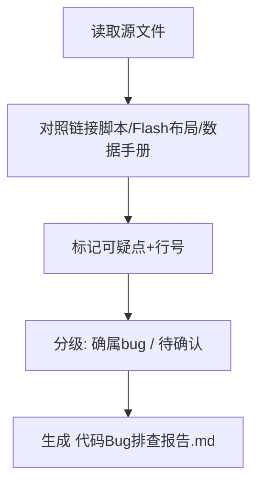

## 用户需求

排查工程内网络（LWIP/TCP）、ADS8354（SPI/ADC）以及 IAP Bootloader 相关代码中的潜在 bug 位置，并针对 IAP 问题列出解决方案。串口为测试项，不在本次范围内。

## 产品概述

本工程为 STM32F407 + DP83848 PHY + LwIP(no RTOS) + ADS8354 三路 SPI ADC + 三段式 IAP Bootloader 的嵌入式固件。本次仅做静态走查与定位，不修改代码，最终产出结构化排查报告（含 bug 位置、根因、风险等级与 IAP 修复方案）。

## 核心排查范围

- LWIP 网络初始化、IP/网关配置、配置窗口切换逻辑
- TCP echo server 协议命令解析、pbuf 处理、进入 Bootloader 命令
- ADS8354 SPI 三路 CS/外设映射、SDO 模式字节数、CS 释放
- IAP Bootloader：链接脚本重叠、boot_valid 写流程、TFTP 跳转/校验、VTOR 一致性

## 技术栈

- MCU: STM32F407VG (Cortex-M4, 168MHz, no RTOS)
- 网络: LwIP 2.1.2 (RAW API, NO_SYS=1)
- 外设: SPI1/2/3 (ADS8354 ADC), ETH + DP83848, TIM7
- 存储: 内部 Flash Sector 3 (boot_valid 0x0800FFFC) / Sector 11 (0x080E0000 net_config) / App 区 0x08010000
- 构建: CMake + arm-none-eabi-gcc（分离 APP 与 BOOT 两个镜像）

## 实现方案

本任务为代码审查型，不写新功能，仅对现有代码做逐项静态走查，对照时钟树、Flash 布局、链接脚本、ADS8354 数据手册验证，最终产出结构化 bug 清单与 IAP 解决方案。

### 关键技术决策

1. 按模块分级排查：IAP（最高风险）> LWIP/TCP > ADS8354/SPI。优先排查链接重叠、Flash 写未擦除、跳转未复位、数组越界四类硬故障。
2. 对照权威来源：链接脚本对照 Bootloader 64KB 占用；Flash 写流程对照 `flash_if.c`；SPI 模式对照 ADS8354 数据手册 CFR 寄存器位定义。
3. 复用现有模式：不引入新工具；报告风格与现有 `技术文档.md` 一致，每条含 文件:行号、现象、根因、风险、修复建议。

### 性能与可靠性

- 排查零运行时开销；清单标注 高/中/低 风险，便于优先修复会直接导致 HardFault 或变砖的项（链接重叠、TFTP 直接跳转、boot_valid 未擦除）。
- 区分"确属 bug"与"待确认项"（网关、配置窗口、SDO 字节数、SPI 外设映射）单列。

## 实现说明（执行要点）

- 不修改任何源文件，仅读取与交叉验证。
- 重点走查：APP 链接脚本 FLASH 起始与 Bootloader 重叠；`CMD_ENTER_BOOTLOADER` 写 boot_valid 未擦除；`tftp_server.c` 末包直接跳转未复位；`net_config_poll` 窗口逻辑；`ads8354.c` CS/外设/SDO。
- 最终输出写入新文档 `代码Bug排查报告.md`，引用精确行号。

## 架构设计

本任务为审查型，无架构改动。数据流：读取源文件 → 对照参考 → 标记可疑点+行号 → 分级 → 生成报告。



## 目录结构

```
c:/ST_project/DP83848/
├── 代码Bug排查报告.md           # [NEW] 排查结论清单（IAP/LWIP/TCP/ADC_SPI）。每条含 文件:行号、现象、根因、风险、修复建议；末尾单列待确认项与 IAP 解决方案小节。
├── Core/Src/tcp_echoserver.c    # [READ] CMD_ENTER_BOOTLOADER:361-399 写 boot_valid；recv 回调 pbuf 处理
├── Core/Src/net_config.c        # [READ] net_config_poll:207-228 窗口逻辑；get_entry_ip:187-195
├── LWIP/App/lwip.c              # [READ] 网关 0.0.0.0:71-74；配置窗口缺失
├── Bootloader/lwip_boot.c       # [READ] 网关:53；Boot_LWIP_Init
├── Bootloader/tftp_server.c     # [READ] 末包跳转:175-192；块号校验:103-134
├── Bootloader/flash_if.c/.h     # [READ] 地址/扇区/写流程
├── Bootloader/bootloader_main.c # [READ] APP_START_ADDR:18；jump_to_app:64-79
├── ADS8354/ads8354.c            # [READ] Ads8354Init:117-121；Ads8354ReadConvers:137-166；CS 释放
├── STM32F407XX_APP.ld           # [READ] FLASH ORIGIN=0x08000000 冲突
└── Bootloader/STM32F407XX_BOOT.ld # [READ] FLASH ORIGIN=0x08000000 LENGTH=64K
```